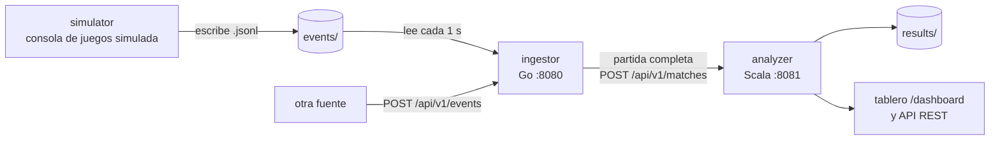

# GameStats

[](https://github.com/AndresZum04/gamestats/actions/workflows/ci.yml)

GameStats recibe eventos de partidas de videojuegos, los organiza en Go y los analiza en Scala. Calcula estadísticas por jugador, por partida y por juego, detecta patrones como remontadas, rachas o venganzas, y muestra todo en un tablero web.

Proyecto 1 del curso Lenguajes de Programación, Instituto Tecnológico de Costa Rica.

## Arquitectura



- simulator (Go): genera partidas de carreras, combate y ajedrez en paralelo y escribe sus eventos en una carpeta compartida, como lo hará la consola de juegos de la segunda parte del curso.
- ingestor (Go): lee la carpeta de forma continua, valida cada evento, agrupa por partida con una goroutine por partida y envía cada partida completa al analyzer, con reintentos y un outbox en disco.
- analyzer (Scala): calcula 19 estadísticas y 6 patrones con funciones puras, guarda un JSON por partida y los sirve por REST y en el tablero.

El detalle está en [docs/arquitectura.md](docs/arquitectura.md).

## Requisitos

Para instalar y usar: Docker con Docker Compose v2. Nada más.

Para desarrollar sin Docker: Go 1.22, Java 21 y sbt 1.10.

## Inicio rápido

```bash
git clone https://github.com/AndresZum04/gamestats.git
cd gamestats
./install.sh                                              # Linux y macOS
powershell -ExecutionPolicy Bypass -File .\install.ps1    # Windows
```

El instalador verifica Docker y los puertos, compila todo desde el código fuente y deja los servicios corriendo. La primera vez tarda unos minutos.

Después, para generar partidas:

```bash
docker compose --profile demo run --rm simulator
```

y abrir el tablero en http://localhost:8081/dashboard. Las partidas aparecen a medida que terminan, sin recargar la página.

También se puede cargar un dataset copiándolo a la carpeta de eventos:

```bash
cp data/samples/demo-small.jsonl gamestats-data/events/
```

Detalles, instalación manual y problemas comunes: [docs/instalacion.md](docs/instalacion.md).

### Sin el instalador

```bash
docker compose up -d --build --wait
docker compose --profile demo run --rm simulator
```

## Ejecución local sin Docker

En tres terminales, desde la raíz del repositorio:

```bash
cd analyzer && sbt run                                       # puerto 8081
cd ingestor && go run ./cmd/ingestor                         # puerto 8080, usa ../data
cd simulator && go run ./cmd/simulator --events-dir ../data/events
```

El simulador tiene tres modos:
- `--mode stream` (por defecto): escribe en la carpeta compartida a ritmo acelerado, como una consola.
- `--mode file --out archivo.jsonl`: escribe todo de una vez. Es reproducible: la misma semilla da el mismo archivo.
- `--mode http --target http://localhost:8080`: envía por la API.

`--help` muestra todas las opciones.

## API

| Servicio | Endpoint | Qué devuelve |
| --- | --- | --- |
| ingestor | `POST /api/v1/events` | recibe un evento o un arreglo de hasta 1000 |
| ingestor | `GET /api/v1/matches`, `/matches/{id}` | partidas en memoria y su estado |
| ingestor | `GET /api/v1/rejected?limit=50` | últimos eventos rechazados con su motivo |
| ingestor | `GET /api/v1/stats` | recibidos, aceptados, rechazados por código, partidas activas, lotes enviados, goroutines |
| analyzer | `GET /api/v1/matches?gameId=&limit=` | partidas analizadas, las más recientes primero |
| analyzer | `GET /api/v1/matches/{id}` | análisis completo de una partida |
| analyzer | `GET /api/v1/players/{id}` | registro de un jugador en cada juego |
| analyzer | `GET /api/v1/games/{id}/summary` | resumen del juego: abandono, arma más efectiva, duración promedio |
| analyzer | `GET /api/v1/games/{id}/leaderboard` | ranking del juego |
| analyzer | `GET /api/v1/patterns?gameId=&patternId=` | patrones detectados |
| analyzer | `GET /dashboard` | tablero web |
| ambos | `GET /health` | `{"status":"ok"}` |

## Pruebas

```bash
cd ingestor && go test -race ./...      # 8 paquetes con pruebas, incluida una de punta a punta
cd simulator && go test -race ./...
cd analyzer && sbt test                 # 84 pruebas de munit
scripts/smoke-test.sh                   # contra el sistema levantado
```

`go test -race` necesita gcc. En Windows se puede correr en Docker: `docker run --rm -v "$PWD:/repo" -w /repo/ingestor golang:1.22 go test -race ./...`.

La CI corre todo esto en cada push, más una prueba del instalador en una máquina limpia ([docs/cicd.md](docs/cicd.md)).

## Despliegue

Cada cambio en `main` publica las imágenes en GitHub Container Registry y actualiza una VM de Azure. Ver [docs/deployment.md](docs/deployment.md).

Tablero desplegado: *pendiente de crear la VM.*

## Documentación

| Documento | Contenido |
| --- | --- |
| [eventos.md](docs/eventos.md) | Formato de eventos, catálogo por juego, códigos de rechazo, cómo agregar un juego |
| [juegos.md](docs/juegos.md) | Por qué carreras y combate, y qué permite calcular cada evento |
| [estadisticas.md](docs/estadisticas.md) | Cada estadística y patrón con su fórmula, archivo y ejemplo real |
| [arquitectura.md](docs/arquitectura.md) | Componentes, recorrido de un evento, concurrencia y por qué HTTP entre Go y Scala |
| [paradigmas.md](docs/paradigmas.md) | Qué se hizo imperativo y qué funcional, y por qué |
| [consola-futura.md](docs/consola-futura.md) | Cómo se conectará la consola de juegos de la segunda parte |
| [instalacion.md](docs/instalacion.md) | Instalación, desinstalación y problemas comunes |
| [cicd.md](docs/cicd.md) | Qué hace cada job de CI y CD |
| [deployment.md](docs/deployment.md) | Despliegue en Azure y cómo volver a una versión anterior |
| [demo.md](docs/demo.md) | Guion de la demostración |
| [decisiones.md](docs/decisiones.md) | Registro de decisiones tomadas durante el desarrollo |

## Estructura

```text
ingestor/     Go: ingestión, validación, pipeline concurrente, envío
simulator/    Go: consola de juegos simulada y escenarios de patrones
analyzer/     Scala: análisis funcional, API REST y tablero
configs/      tipos de evento permitidos por juego
schemas/      JSON Schema del sobre común
data/samples/ datasets de ejemplo (semilla 42)
deploy/       compose de producción y scripts de la VM
scripts/      prueba de humo y demo
docs/         documentación
```
