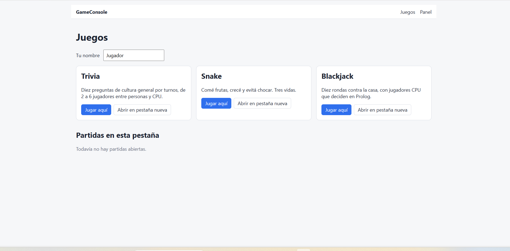
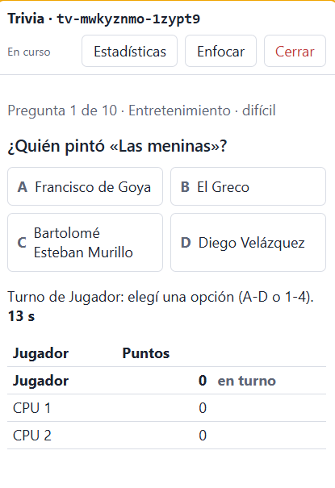
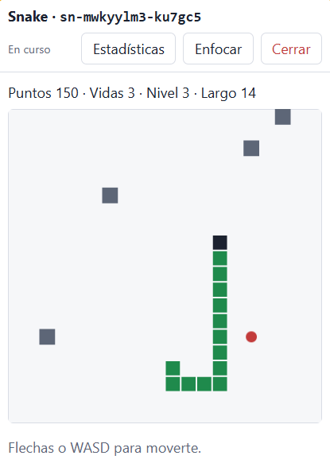
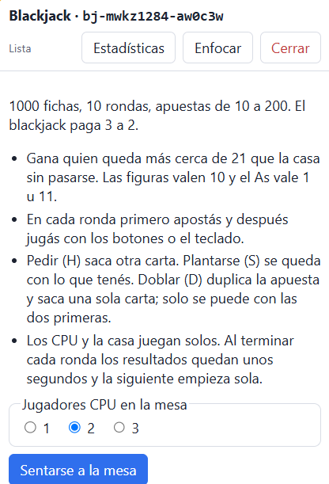
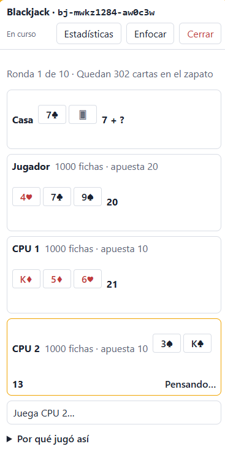
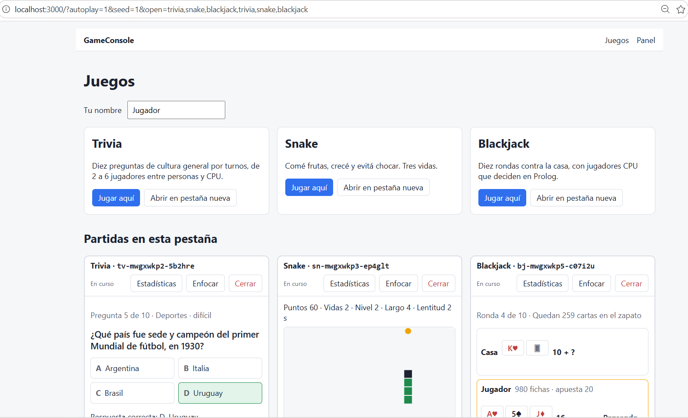
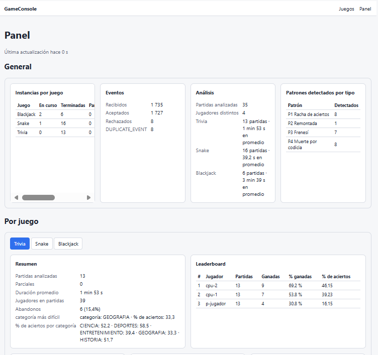
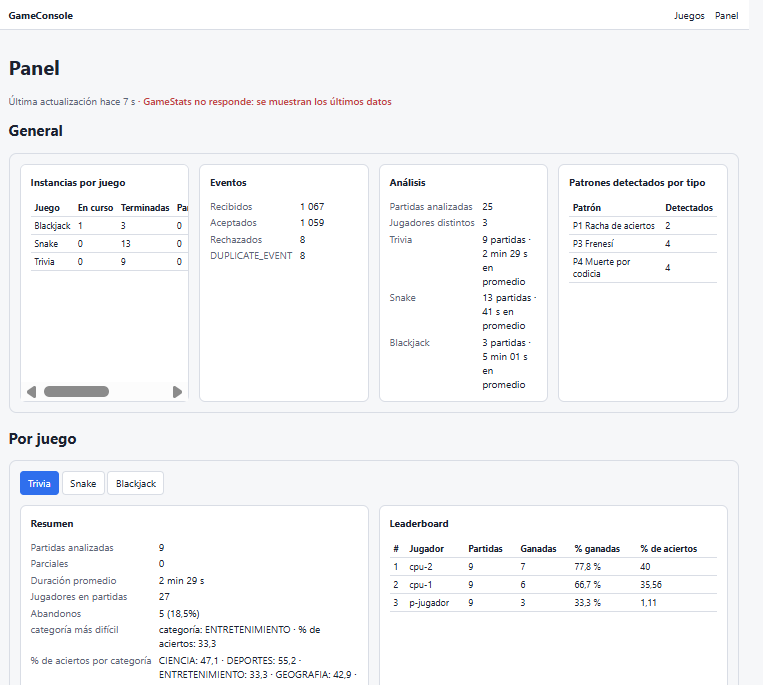
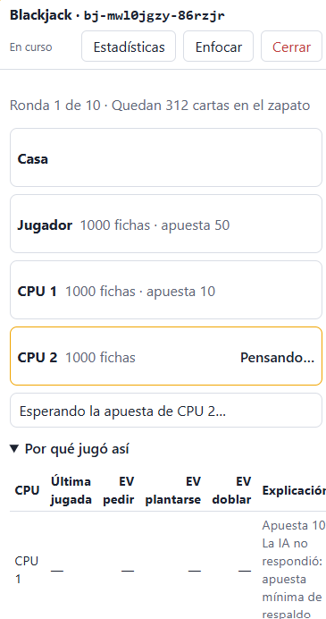
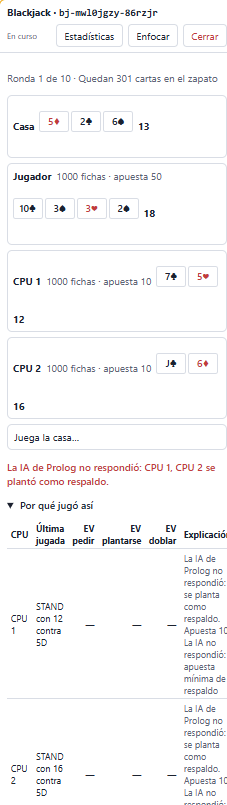

# GameConsole
[](https://github.com/AndresZum04/gamestats/actions/workflows/ci.yml)


## Qué es y cómo se conecta con GameStats

GameConsole es una consola web que puede ejecutar varios juegos simultaneamente, mostrar la cantidad de partidas en ejecucion y enviar sus eventos detectados en archivos JSON a un analizador de eventos y patrones llamado GameStats

## Requisitos
Docker con Compose 2.24 o mayor
Los puertos 3000, 4000, 8080 y 8081 libres
Internet durante la primer instalacion

## Instalación
pasos de la instalacion a detalle en [instrucciones.md](https://github.com/AndresZum04/gamestats/blob/main/console/docs/instalacion.md)

#### Paso 1 - clonar repositorio

Clonar el repositorio con:
```bash
git clone https://github.com/AndresZum04/gamestats.git
cd gamestats
cd console
```
No hay submódulo: la consola vive en la carpeta `console/` dentro del mismo repositorio de GameStats. Todas las rutas de este documento son relativas a `console/` y los comandos se corren desde ahí.

#### Paso 2 - ejecutar instalador

En Linux o Mac: 
```bash
./install.sh
```
En Windows: 
```bash
powershell -ExecutionPolicy Bypass -File .\install.ps1
```
#### Paso 3 - ejecución de la consola

Para probar la consola localmente se debe abrir este link: `http://localhost:3000`

#### Desinstalacion
En Linux o Mac:
```bash
./uninstall.sh
```

en Windows:
```bash
powershell -ExecutionPolicy Bypass -File .\uninstall.ps1
```

## Cómo jugar
una vez instalado GameConsole, se debe abrir este link para jugar localmente: http://localhost:3000/

También está desplegado en una VM de Azure, sin instalar nada: http://130.131.106.122:8080 (el tablero de GameStats de esa misma VM está en http://130.131.106.122:8081/dashboard). Se actualiza solo con cada cambio en `main`; los detalles están en [deployment.md](../docs/deployment.md).

una vez en gameconsole se presentara la siguiente pantalla


para jugar un juego en esa misma pestaña se debe hacer click en el boto azul que dice "jugar", pero si se quiere jugar en otra pestaña, se debe hacer click en el boton blanco que dice "abrir en pestaña nueva" y el juego se ejecutara en otra pestaña.

Los juegos son muy intuitivos, pero para los juegos que no son tan obvios como el snake o el blackjack, se cuentan con instrucciones en la parte inferior de la pantalla de juego (el recuadro en el que se ejecuta el juego) del snake, y antes de iniciar la partida en el blackjack.

### ejemplos de partidas en ejecucion:

#### Trivia

#### Culebrita

#### Blackjack
##### apuesta

##### juego


## Varias instancias a la vez
GameConsole puede registrar eventos de partidas concurrentes, enviarlos a GameStats,  y cada evento se actualiza en el panel de manera concurrente.

### ejemplo de concurrencia

#### GameConsole ejecutando varios juegos a la vez


#### GameStats reflejando eventos en el panel


## Panel de estadísticas
GameConsole trabaja en conjunto con GameStats. GameConsole ejecuta juegos  y envia sus eventos a GameStats, quien procesa y analiza esos eventos en busca de patrones y los ilustra en el panel de GameConsole.
Cabe recalcar que GameConsole no analiza los juegos de su panel en ninguna manera, solo se limita a enviar eventos y dejar esa responsabilidad a GameStats.

#### Panel de estadisticas de GameConsole


## Pruebas
GameConsole tiene tres tipos de pruebas. Todos los comandos se corren desde la carpeta `console` del repositorio clonado, en una terminal (PowerShell, cmd o Git Bash en Windows; la terminal normal en Linux o Mac). Se necesita Node.js 20 o más nuevo.

Las tres se corren solas en GitHub Actions con cada cambio (el badge de CI de arriba muestra si pasaron).

### 1. Pruebas unitarias (Vitest)

Prueban cada pieza por separado, sin levantar nada: las reglas de cada juego, los eventos que genera, el envío a GameStats, el servidor de la consola y el formato del panel.

```bash
npm ci        # instala las dependencias (solo la primera vez)
npm run test  # corre las pruebas
```

Son 254 pruebas en tres partes:

| Parte | Qué prueba | Pruebas |
| --- | --- | --- |
| `shared` | que cada evento cumpla el esquema y el contrato de GameStats | 123 |
| `web` | los juegos (Trivia, Serpiente, Blackjack), las instancias, el envío de eventos y el panel | 105 |
| `server` | el servidor de la consola: recibir y reenviar eventos, el puente a Prolog y las estadísticas | 26 |

Al final cada parte muestra una línea como `Tests  105 passed (105)`. Si algo falla, dice qué prueba fue y por qué.

### 2. Pruebas de la IA en Prolog (plunit)

Prueban las reglas de `prolog/blackjack_ai.pl`: el valor de las manos, el cálculo del valor esperado (EV) y las apuestas. Son 15 pruebas. Como no hace falta instalar SWI-Prolog, se corren con Docker:

En Linux, Mac o Git Bash:
```bash
docker run --rm -v "$PWD/prolog:/app" -w /app swipl:10.0.2 swipl -g run_tests -t halt tests/blackjack_ai.plt
```
En PowerShell:
```bash
docker run --rm -v "${PWD}/prolog:/app" -w /app swipl:10.0.2 swipl -g run_tests -t halt tests/blackjack_ai.plt
```
Al final dice `All 15 tests passed`.

### 3. Pruebas de punta a punta (Playwright)

Abren un navegador de verdad (Chromium) y usan la consola como lo haría una persona, con el sistema completo corriendo: consola, GameStats y Prolog. Por eso **primero hay que tener la consola instalada y abierta** (paso 2 de la instalación) en `http://localhost:3000`.

```bash
npx playwright install chromium  # descarga el navegador (solo la primera vez)
npm run e2e
```

Son 4 pruebas y tardan unos 3 minutos:

| Prueba | Qué comprueba |
| --- | --- |
| `blackjack-person` | una persona juega dos rondas de Blackjack con los botones |
| `concurrency` | 6 partidas automáticas al mismo tiempo (3 en una consola y 3 en otras pestañas) llegan a GameStats sin mezclarse |
| `panel` | el panel muestra una partida en curso con sus estadísticas parciales y después la partida terminada |
| `prolog` | una mesa de Blackjack con 3 CPU termina, y los CPU decidieron con Prolog |

Al final dice `4 passed`. Si una falla, en `e2e/playwright-report` queda un reporte con capturas; se abre con `npx playwright show-report e2e/playwright-report`.

## manejo de errores
Varios juegos y el mismo GameConsole pueden manejar errores.
### Panel
en el caso de que se pierda conexion con GameStats, el panel muestra los ultimos eventos antes de que se perdiera la conexion mientras GameConsole guarda los nuevos eventos que esten ocurriendo en ese momento y apenas recupere conexion los envia a GameStats para que siga su curso.

#### caso en el que gameStats no responde

### BlackJack
en el caso que la IA en prolog deje de responder, se manejan dos acciones predeterminadas de respaldo:
1. al apostar, se apuesta el minimo de 10 fichas
2. al jugar, siempre se elije plantarse (STAND)
#### Caso en el que prolog no responde

##### apuesta
aqui el jugador cpu 1 apuesta 10 fichas como accion predeterminada

##### jugada
aqui los jugadores cpu 1 y 2 eligieron plantarse como jugada predeterminada


## Enlaces y video

[link a la demostracion en video](https://youtu.be/D3QLwy_p030)

