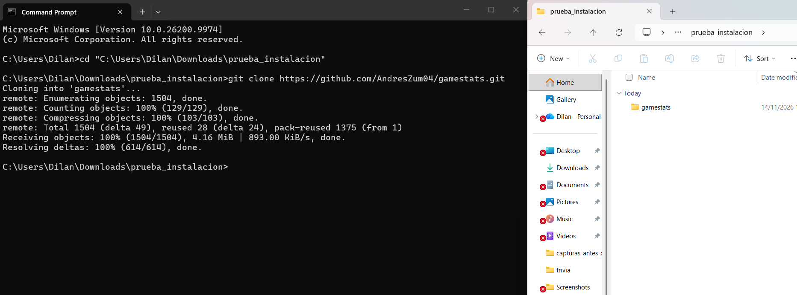
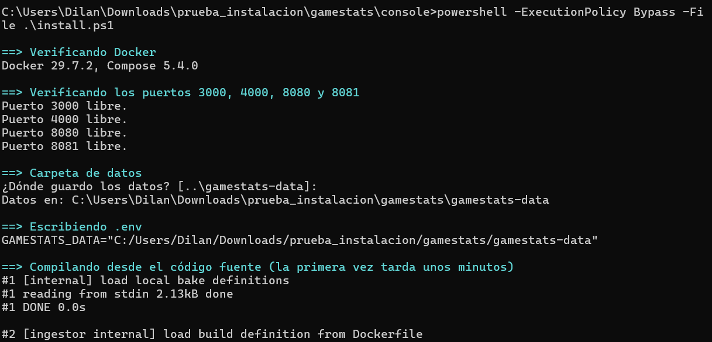
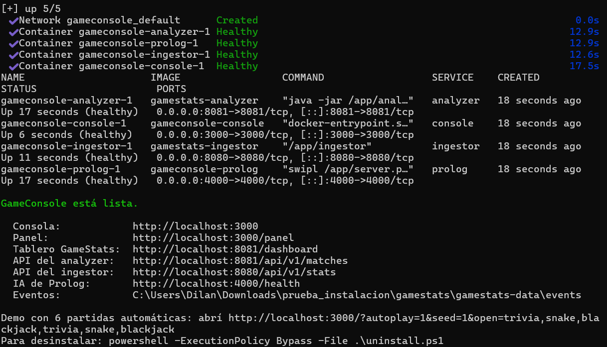
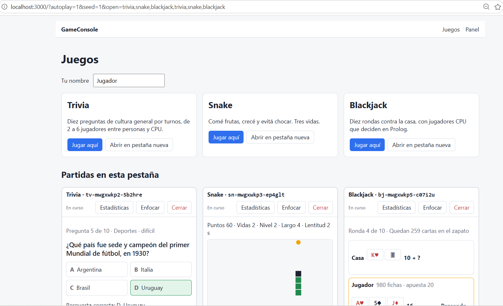
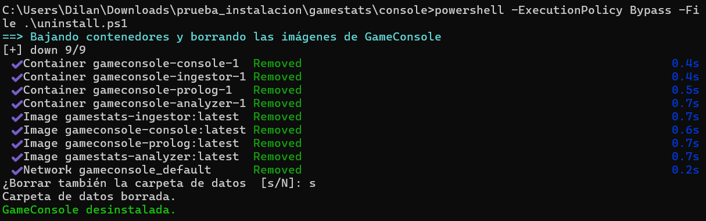

# instalacion de la consola desde docker
## Requisitos
- Docker con Compose 2.24 o mayor
- Git bash 
- Los puertos 3000, 4000, 8080 y 8081 libres
- Internet durante la primer instalacion
  
## instalacion

primero hacemos "cd " hacia la carpeta en la que queramos hacer la instalacion

#### Paso 1 - clonar repositorio

Clonar el repositorio con:
```bash
git clone https://github.com/AndresZum04/gamestats.git
cd gamestats
cd console
```
No hay submódulo: la consola vive en la carpeta `console/` dentro del mismo repositorio de GameStats. Todas las rutas de este documento son relativas a `console/` y los comandos se corren desde ahí.

#### Paso 2 - ejecutar instalador

En Linux o Mac: 
```bash
./install.sh
```
En Windows: 
```bash
powershell -ExecutionPolicy Bypass -File .\install.ps1
```
#### Paso 3 - ejecución de la consola

Para probar la consola localmente se debe abrir este link: `http://localhost:3000`

# Desinstalacion
En Linux o Mac:
```bash
./uninstall.sh
```

en Windows:
```bash
powershell -ExecutionPolicy Bypass -File .\uninstall.ps1
```
### ejemplo de ejecucion

Estas capturas fueron tomadas de la instalacion en la laptop de Dilan Andrey Sibaja Ugalde, con Docker Compose version v5.4.0.

Clonacion del repositorio:

Instalacion:

Resultados de la instalacion:

Ejecucion con partidas automaticas en `http://localhost:3000/?autoplay=1&seed=1&open=trivia,snake,blackjack,trivia,snake,blackjack`:

Desinstalacion:


# Problemas comunes

