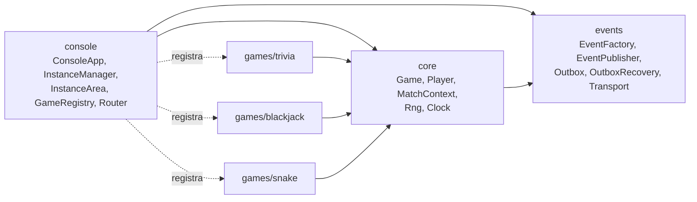
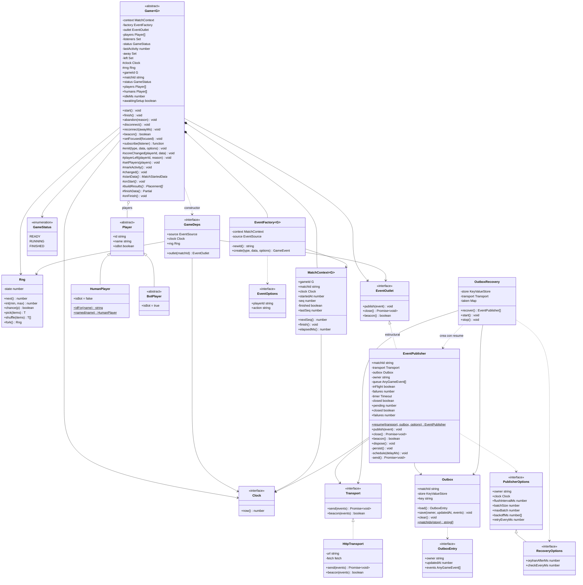
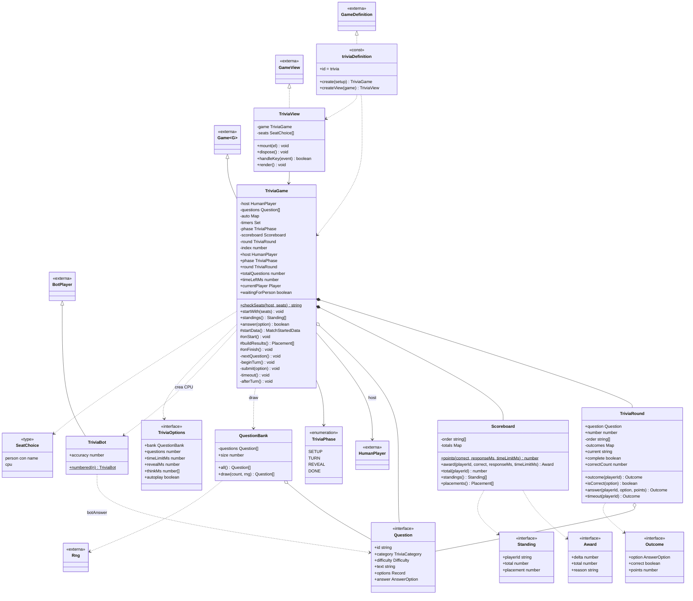
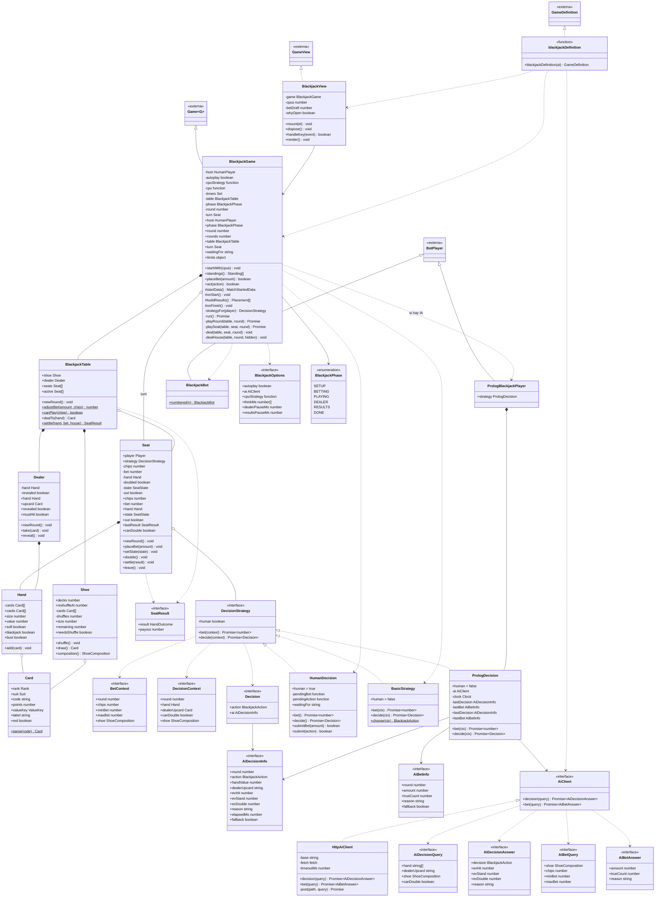
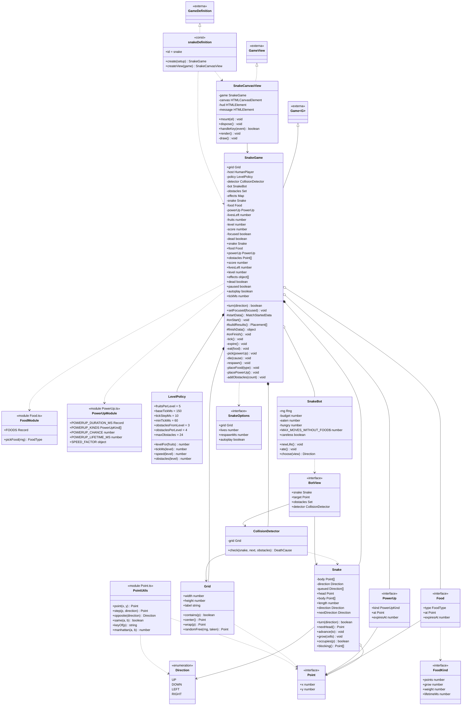
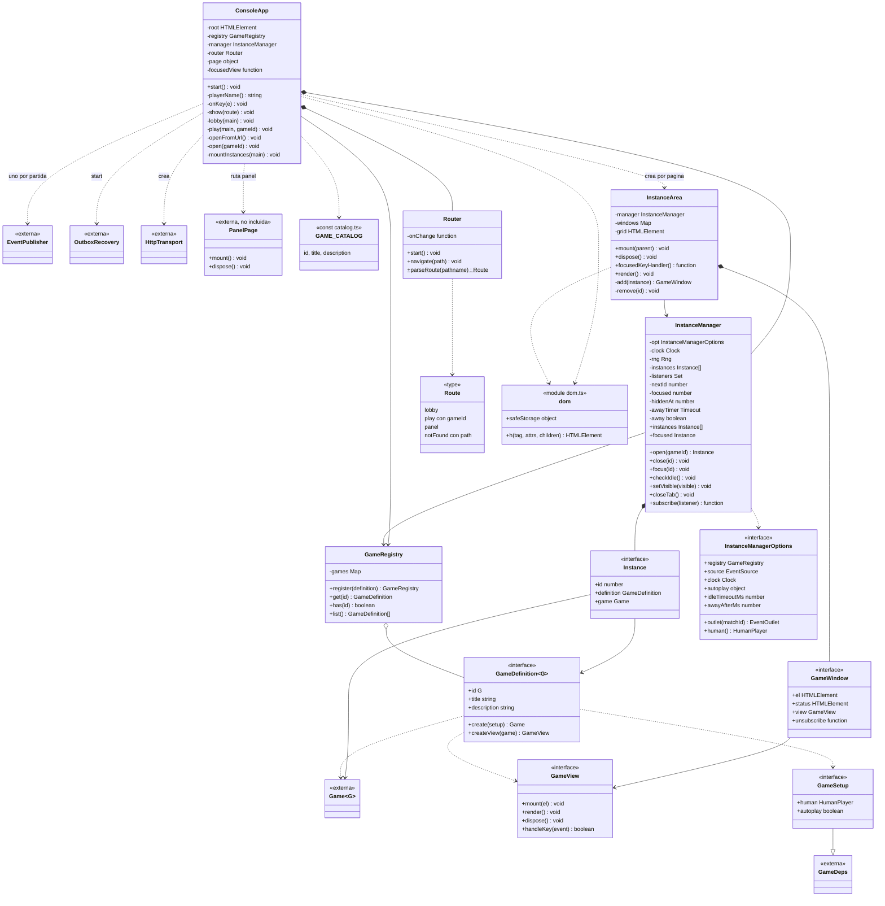

# diagrama de la arquitectura

## 0. Vista general de paquetes
 

## 1. Núcleo (core) y eventos (events)
 

 
## 2. Trivia
 

 
## 3. Blackjack
 

 
## 4. Snake
 

 
## 5. Consola (UI y orquestación)
 

## Reglas de diseño

1. Las clases de lógica no tocan el DOM ni `fetch`. Las vistas no cambian el estado del juego directamente; llaman métodos del juego.
2. Atributos privados (`#campo` o `private`) y estado expuesto solo por métodos de lectura.
3. Herencia solo donde hay un "es un" real (`Game`, `Player`); lo demás por composición (`BlackjackTable` tiene un `Shoe`, un `Dealer` y asientos).
4. `Rng` con semilla inyectable en cada juego para que las pruebas y el modo automático sean reproducibles.