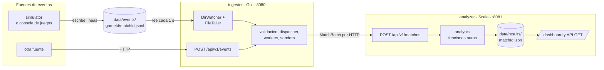

# Arquitectura

GameStats son tres procesos independientes que solo se comunican por archivos JSON y por HTTP:

- simulator (Go): hace de consola de juegos. Genera partidas y escribe sus eventos en una carpeta compartida.
- ingestor (Go): lee esa carpeta (o recibe eventos por HTTP), valida, agrupa por partida con una goroutine por partida y envía cada partida completa al analyzer.
- analyzer (Scala): calcula estadísticas y detecta patrones con funciones puras, guarda los resultados en JSON y los sirve por REST y en un tablero web.

Go no calcula ninguna métrica de juego y Scala no valida el formato básico de entrada. Esa división es la del enunciado y la que se defiende en [paradigmas.md](paradigmas.md).

## Recorrido de un evento

1. El juego escribe. El simulador (y en la segunda parte, la consola) agrega una línea al archivo `data/events/<gameId>/<matchId>.jsonl` por cada evento. Las reglas para escribir esos archivos están en [eventos.md](eventos.md).
2. El ingestor lo descubre. El `DirWatcher` es una goroutine que recorre la carpeta cada segundo. Por cada archivo nuevo o que creció lanza un `FileTailer`, otra goroutine que lee solo las líneas completas desde el último offset. Los offsets se guardan en `data/state/offsets.json`, así un reinicio no vuelve a leer lo ya procesado.
3. Se valida. `Intake` aplica las reglas en el orden de la tabla de códigos: JSON válido, campos del sobre, juego y versión registrados, tipo permitido, jugador, claves de `data`. Después `Dedup` descarta los `eventId` repetidos. Los rechazados van a `data/rejected/rejected.jsonl` con su código. Los eventos que llegan por `POST /api/v1/events` pasan exactamente por el mismo `Intake`.
4. Se agrupa por partida. El evento válido entra a un canal con buffer de 10 000. El dispatcher lo reenvía al worker de su `matchId` y, si la partida es nueva, crea ese worker.
5. El worker arma la partida. Cada worker es dueño del estado de su partida: jugadores activos, desconectados o retirados, eventos y estado. Cuando llega `MATCH_FINISHED` y ya tiene todos los `seq` del 1 al del fin, ordena los eventos por `seq` y emite un `MatchBatch` `COMPLETE`. Si pasan 120 s sin eventos, emite uno `PARTIAL`.
6. Se envía a Scala. Un pool de 4 senders hace `POST /api/v1/matches`. Ante errores de red, 5xx o 429 reintenta tres veces (500 ms, 1 s, 2 s). Si siguen fallando, guarda el lote en `data/outbox/`, que se reintenta cada 30 s.
7. Scala analiza. `Routes` decodifica el lote y elige el analizador del juego (o el genérico). El análisis es una función pura: `buildContext andThen computeStats andThen attachPatterns`. `ResultStore` lo guarda en un `Ref` y en `data/results/<matchId>.json`.
8. Se consulta. La API REST y el tablero leen el `Ref`. Los agregados entre partidas (leaderboard, resumen por juego) también son funciones puras sobre la lista de resultados.

## El ingestor por dentro

```mermaid
flowchart TB
  tailers[FileTailer x N<br/>una goroutine por archivo] --> intake
  httpin[handler HTTP] --> intake
  intake[Intake<br/>validar + Dedup] -- rechazos --> rej[RejectedWriter<br/>una goroutine dueña del archivo]
  intake -- "chan Event (10 000)" --> disp[Dispatcher<br/>dueño del mapa matchId → canal]
  disp -- "chan Event (256)" --> w1[worker rp-0001]
  disp --> w2[worker ac-0003]
  disp --> w3[worker ...]
  w1 -- done --> disp
  w1 -- "chan MatchBatch" --> senders
  w2 --> senders
  w3 --> senders
  senders[pool de 4 senders] -- POST --> analyzer[(analyzer)]
  senders -- falla --> outbox[(outbox/)]
  retrier[OutboxRetrier cada 30 s] --> outbox
  w1 -. instantánea .-> reg[Registry<br/>RWMutex] --> api[GET /api/v1/matches, /stats]
```

Cada estructura tiene un solo dueño, y eso es lo que evita los locks en casi todo el pipeline:

- El mapa `matchId → canal` lo toca solo el dispatcher.
- El `MatchState` de una partida lo toca solo su worker.
- El archivo de rechazos lo escribe solo el `RejectedWriter`.

Lo que sí se comparte tiene su protección. El registro de instantáneas que lee la API usa un `RWMutex`, `Dedup` usa un `Mutex` porque lo llaman muchos tailers a la vez, y los contadores de `/stats` son atómicos.

Tres detalles de concurrencia que costaron diseño:

- Contrapresión. Si el canal de entrada se llena, los tailers esperan (el archivo no se pierde) y el HTTP responde 503 con `Retry-After: 1`.
- Cierre de una partida sin deadlock. El worker avisa "me cierro" por un canal al dispatcher y, mientras espera, sigue leyendo su propio canal. Si dejara de leerlo, el dispatcher podría quedarse bloqueado enviándole un evento mientras el worker espera que le reciban el aviso. Los eventos que llegan después se rechazan como `LATE_EVENT`.
- Apagado en cascada. Con SIGINT o SIGTERM se detienen las fuentes, se guardan los offsets y se cierra el canal de entrada. El dispatcher cierra el canal de cada worker, cada worker emite su partida como `PARTIAL` y los senders la guardan en el outbox. Ninguna etapa necesita que le avisen aparte: le basta ver su canal cerrado. Todo tiene un límite de 15 s.

## El analyzer por dentro

| Paquete | Qué hace | Efectos |
| --- | --- | --- |
| `model/` | `Event`, `MatchBatch`, eventos tipados (`enum`) y resultados | ninguno |
| `codec/` | Codecs de circe y conversión de `Event` a eventos tipados | ninguno |
| `analysis/` | Estadísticas G, R y A, patrones P1 a P6 y agregados | ninguno: solo funciones puras |
| `store/` | `ResultStore`: un `Ref[IO, Map]` y un JSON por partida | archivos |
| `http/` | Rutas http4s, reloj, logs | red, reloj, logs |

La línea entre `analysis/` y el resto es la separación que se defiende en la exposición. `StyleSuite` la hace cumplir: la compilación de pruebas falla si `analysis/` usa `var`, colecciones mutables, `null`, `cats.effect` o lectura y escritura de archivos.

## Por qué HTTP entre Go y Scala

Las alternativas eran una carpeta compartida (Go escribe lotes, Scala los lee) o un sistema de mensajería como RabbitMQ o Kafka. Se eligió HTTP por cuatro razones:

- Contrato explícito. `POST /api/v1/matches` con un `MatchBatch` y una respuesta 200, 400 o 500 está documentado en el plan y se puede probar con `curl`.
- Confirmación inmediata. El 200 le dice a Go que la partida quedó analizada y guardada, y recién ahí la marca `SENT`. Con archivos haría falta un segundo mecanismo para confirmar.
- Idempotencia. Reenviar el mismo `matchId` reemplaza el resultado anterior, así que los reintentos y el outbox nunca duplican datos.
- Instalación simple. Una cola de mensajes agrega un servicio más que instalar, configurar y monitorear, y el profesor pidió que la instalación en su máquina fuera simple. Lo que una cola daría (no perder mensajes si el destino está caído) lo cubren los reintentos y el outbox en disco.

La entrada de eventos, en cambio, sí es por archivos: así lo describió el profesor para la consola de la segunda parte. HTTP queda como entrada alternativa.

## Puertos, carpetas y configuración

| Servicio | Puerto | Variables principales |
| --- | --- | --- |
| ingestor | 8080 | `ANALYZER_URL`, `DATA_DIR`, `CONFIG_DIR`, `WATCH_INTERVAL` (1s), `MATCH_IDLE_TIMEOUT` (120s), `MATCH_FINISH_GRACE` (5s), `SENDER_WORKERS` (4), `INPUT_BUFFER` (10000) |
| analyzer | 8081 | `PORT`, `RESULTS_DIR` |

| Carpeta (`GAMESTATS_DATA`) | Quién escribe | Contenido |
| --- | --- | --- |
| `events/` | juegos o simulador | un `.jsonl` por partida |
| `rejected/` | ingestor | `rejected.jsonl` con cada rechazo y su motivo |
| `state/` | ingestor | `offsets.json`, hasta dónde se leyó cada archivo |
| `outbox/` | ingestor | lotes que no se pudieron enviar todavía |
| `results/` | analyzer | un `MatchAnalysis` por partida |
