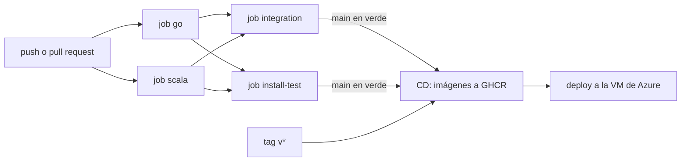
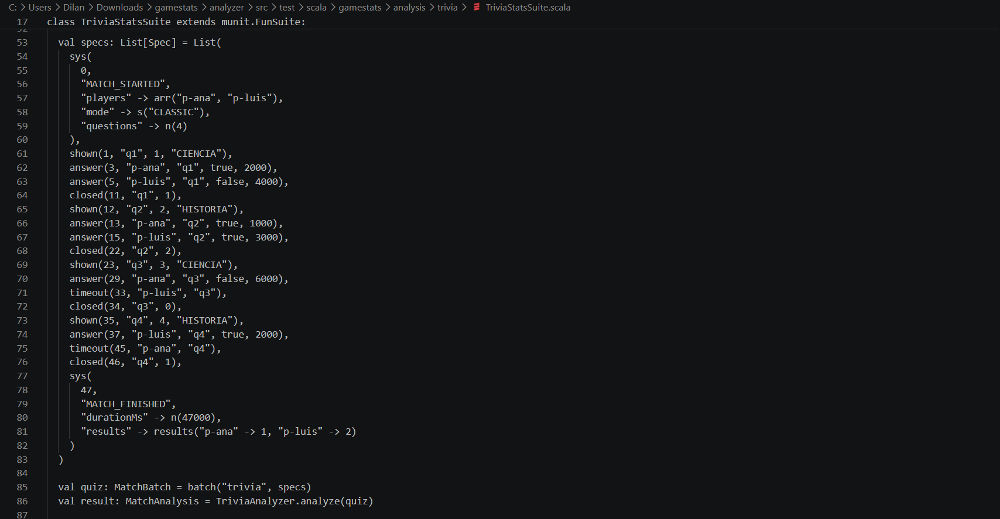
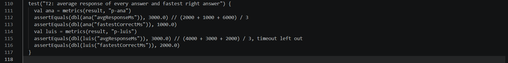
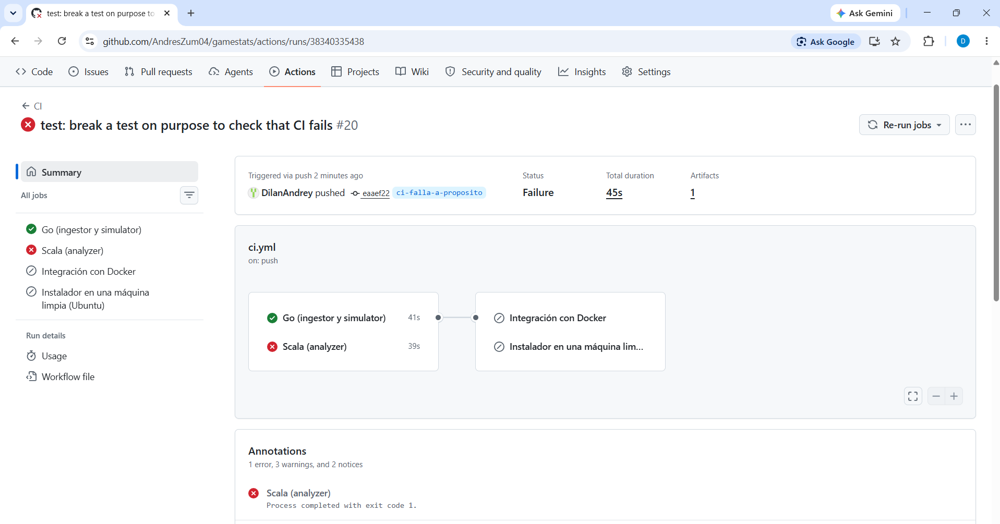

# Integración y entrega continua

GameStats usa GitHub Actions con dos workflows:

- `ci.yml` compila y prueba en cada push y pull request.
- `cd.yml` publica las imágenes y despliega cuando la CI de `main` termina bien o cuando se crea un tag `v*`.



## CI (`.github/workflows/ci.yml`)

### Job `go`

Para el ingestor y el simulador:

1. `gofmt -l`: falla si algún archivo no tiene el formato estándar.
2. `go vet ./...`: errores comunes que compilan pero están mal.
3. `go test -race -coverprofile=coverage.out ./...`: todas las pruebas con el detector de carreras, que es lo que valida la concurrencia del pipeline. Imprime la cobertura total.
4. `go build ./...`.

Sube `coverage.out` de los dos módulos como artefacto `go-coverage`.

### Job `scala`

Para el analyzer: `sbt scalafmtCheckAll test assembly`.

- `scalafmtCheckAll` falla si el código no tiene el formato de `.scalafmt.conf`.
- `test` corre las 84 pruebas de munit, incluida `StyleSuite`, que falla si el paquete `analysis/` usa `var`, colecciones mutables, `null` o efectos.
- `assembly` arma `analyzer.jar`, que se sube como artefacto `analyzer-jar`.

### Job `integration`

Corre después de los dos anteriores. Prueba el sistema completo como en producción:

1. Crea la carpeta de datos y le pasa a compose el uid del runner.
2. `docker compose --profile demo build`: construye las tres imágenes desde el código fuente.
3. `docker compose up -d --wait`: levanta analyzer e ingestor y espera a que estén sanos.
4. Corre el simulador con semilla 42, que siempre genera las mismas 18 partidas: 4 de trivia, 4 de snake, 4 de blackjack y las 6 de escenario.
5. `scripts/smoke-test.sh` verifica cuatro cosas:
   - que el analyzer tiene las 18 partidas;
   - que aparecen los 6 patrones;
   - que el tablero, el leaderboard y el resumen de trivia, snake y blackjack responden;
   - que el ingestor rechazó exactamente los eventos inválidos que reportó el simulador, con el outbox vacío.
6. Junta los archivos en `ci-artifacts/`:
   - `logs/compose.log` con los logs de todos los contenedores;
   - `logs/simulator.log`;
   - `results/` con los JSON de resultados, copiados del contenedor con `docker compose cp`.

   Los empaqueta en `ci-artifacts.tar.gz` y lo sube. Esto pasa aunque algún paso anterior haya fallado.
7. `docker compose down -v`, siempre.

### Job `install-test`

Prueba el instalador como lo usaría el profesor: un clon recién hecho en una máquina que solo tiene Docker.

1. `./install.sh --yes`.
2. Copia `data/samples/demo-small.jsonl` a la carpeta de eventos y espera sus 12 partidas.
3. Corre el simulador con semilla al azar y espera 30 partidas en total (12 + 18).
4. `./uninstall.sh --yes --delete-data`, siempre.

Corre solo en Ubuntu: los runners de Windows de GitHub no ejecutan contenedores Linux. `install.ps1` se probó a mano en Windows 11 con Docker Desktop.

## CD (`.github/workflows/cd.yml`)

### Job `images`

Corre en paralelo para los tres servicios:

- Construye la imagen con el mismo Dockerfile que usa compose.
- La publica en `ghcr.io/<usuario>/gamestats-<servicio>` con la etiqueta del SHA corto y `latest`, o con el nombre del tag si es una versión.
- Usa la caché de GitHub Actions para no recompilar Scala desde cero cada vez.

### Job `deploy`

Solo corre si existe el secreto `DEPLOY_HOST`:

1. Copia `deploy/` a la VM por SCP.
2. Ejecuta `deploy.sh <tag>` por SSH.
3. Comprueba desde afuera que `http://<host>:8081/health` responde, con hasta 10 intentos.

La configuración de la VM y los secretos están en [deployment.md](deployment.md).

## Cuando algo falla

| Falla | Dónde mirar |
| --- | --- |
| `gofmt` | correr `gofmt -w ingestor simulator` y volver a subir |
| una prueba de Go | el log del paso; con `-race`, el reporte muestra las dos goroutines en conflicto |
| `scalafmtCheckAll` | correr `sbt scalafmtAll` en `analyzer/` |
| `StyleSuite` | el mensaje dice el archivo y la línea con el `var` o el `null` |
| `integration` o `install-test` | descargar `ci-artifacts.tar.gz` y ver `logs/compose.log` |
| `deploy` | el log del paso SSH muestra la salida de `deploy.sh` |

## Correr lo mismo en local

```bash
# job go
for m in ingestor simulator; do (cd $m && gofmt -l . && go vet ./... && go test -race ./...); done
# job scala
cd analyzer && sbt scalafmtCheckAll test assembly
# job integration
docker compose up -d --build --wait
SIM_SEED=42 docker compose --profile demo run --rm simulator
scripts/smoke-test.sh
```

En Windows, `go test -race` necesita gcc. Sin gcc se puede correr dentro de Docker:

```bash
docker run --rm -v "$PWD:/repo" -w /repo/ingestor golang:1.22 go test -race ./...
```

## Verificacion del CI con prueba rota

Se manipulo una prueba para comprobar que el CI protege el codigo correctamente y rechaza un push con una prueba rota. Esta prueba rota se subio en una rama llamada "ci-falla-a-proposito".

en la siguiente imagen se muestra, en la linea 74 del codigo "TriviaStatsSuite" en scala, que el mejor tiempo de respuesta recibido de luis es de 2000ms.

.


la siguiente imagen muestra un trozo de codigo del mismo TriviaStatsSuite, la linea 116 basicamente comprueba que el tiempo lanzado por la simulacion coincide con el tiempo esperado para luis.

.

se realizo una modificacion a esa misma linea, cambiando el tiempo esperado de 2000ms a 2001ms, pero la respuestas lanzadas por el simulador se siguen lanzando tal cual, por lo que el tiempo esperado ya no coincidira con el tiempo recibido. La siguiente imagen muestra el cambio.

.

ahora, cuando se subieron estos cambios a la rama "ci-falla-a-proposito", y se revisaron los actions, se comprobo que el CI acepto el ingestor y simulador pero no acepto el analizer porque el job "Scala (analizer)" fallo debido a lo mencionado anteriormente; se esperaba que el mejor tiempo de respuesta de luis fuese 2001ms pero se recibio 2000ms, por lo que por esta discrepancia se determino que la prueba estaba rota y se rechazo, como se ve en la siguiente imagen.

.


