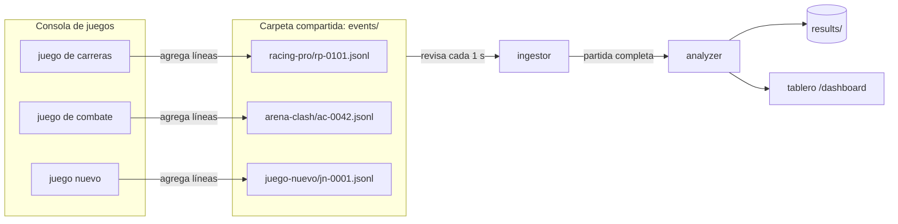

# La consola de juegos de la segunda parte

En el video del proyecto, el profesor adelantó que al final del semestre viene una segunda parte: una consola con juegos reales que generan eventos en el formato que definimos ahora. Esos juegos los dejan en un repositorio de archivos que GameStats lee de forma continua, y los resultados se muestran en un tablero.

GameStats ya está armado para eso. El simulador de esta primera parte hace exactamente lo que hará la consola, y no importa nada del ingestor: solo conoce el formato publicado. Si el simulador funciona, la consola funciona igual.

## Cómo encaja

La consola y GameStats no se conocen. Lo único que comparten es la carpeta `events/` y el formato de los eventos. La consola puede estar escrita en cualquier lenguaje y correr en otra máquina, mientras pueda escribir en esa carpeta (un volumen compartido o una carpeta de red). Si escribir archivos no le conviene, puede mandar los mismos eventos por `POST /api/v1/events`.

## Lo que debe cumplir cada juego

### Al escribir los archivos

1. Un archivo por partida: `events/<gameId>/<matchId>.jsonl`.
2. Solo agregar al final. Nunca reescribir ni borrar líneas ya escritas.
3. Un evento por línea, terminado en `\n`. Si el juego escribe media línea, GameStats espera a que esté completa.
4. Una partida muy larga puede seguir en `<matchId>.part2.jsonl`, `part3` y así: GameStats agrupa por el `matchId` de cada evento, no por el archivo.
5. UTF-8 sin BOM.

### En cada evento

- El sobre común completo, descrito en [eventos.md](eventos.md): `schemaVersion`, `eventId` (UUID v4), `timestamp` en UTC con milisegundos, `gameId`, `gameVersion`, `matchId`, `seq`, `playerId` cuando el tipo lo exija, `type` y `data`.
- `schemaVersion: "1.0"`. Si en la segunda parte hace falta cambiar el sobre, se publica la 2.0 y el ingestor acepta las dos mientras dure la transición.
- `source` con `consoleId` y `sessionId`. Es opcional para la validación, pero permite saber qué consola y qué sesión produjo cada evento cuando haya varias.
- `seq` empezando en 1 y sin huecos. GameStats ordena por `seq` y usa los huecos para saber si todavía faltan eventos antes de cerrar la partida.
- `matchId` único entre todas las consolas. Una forma simple es anteponer el `consoleId`: `c01-rp-0101`. Solo admite letras, dígitos, `-` y `_`, porque se usa como nombre de archivo.
- La partida empieza con `MATCH_STARTED` y termina con `MATCH_FINISHED`. Sin `MATCH_FINISHED`, GameStats la cierra como parcial a los 120 s sin eventos.

### Lo que conviene saber

- Tiempo real. La carpeta se revisa cada segundo, así que un evento aparece en el ingestor en menos de 2 s y la partida en el tablero unos segundos después de terminar.
- Juegos con pausas largas. Un juego por turnos donde alguien piensa más de 2 minutos se cerraría como parcial. Para esos juegos se sube `MATCH_IDLE_TIMEOUT` en la configuración del ingestor, por ejemplo a `15m`.
- Errores. Un evento mal formado no rompe nada: se rechaza con un código y queda en `rejected/rejected.jsonl` y en `GET /api/v1/rejected`. Esa es la primera herramienta para depurar un juego nuevo.

## Agregar un juego

### Lo mínimo: un archivo de configuración

1. Crear `configs/games/<gameId>.json` con los tipos de evento propios y sus claves obligatorias. Los eventos generales (inicio, fin, jugadores, puntaje, turnos y acciones) ya vienen incluidos.
2. Reiniciar el ingestor.

Con eso el juego ya se valida, se agrupa por partida y recibe las estadísticas generales G1 a G6: eventos por tipo, duración, desconexiones, abandono, puntaje y tiempo por turno. Es lo que pasa hoy con `chess-lite`, que no tiene una sola línea de código propia en Go ni en Scala. Un juego que todavía no tiene tipos propios puede reportar con `SCORE_CHANGED`, `TURN_STARTED`, `TURN_ENDED` y `PLAYER_ACTION`.

### Si se quieren métricas propias: un analizador en Scala

1. Un objeto que extienda `ComposedAnalyzer[E]` con la conversión de sus eventos, sus métricas y sus detectores de patrones.
2. Una línea en `AnalyzerRegistry`.

El paso a paso está en [eventos.md](eventos.md#métricas-y-patrones-propios-opcional).

### Lo que no se toca nunca

- El código del ingestor en Go: validar, agrupar y enviar no dependen del juego.
- El sobre común y el contrato `MatchBatch` entre Go y Scala.
- La API REST y el formato de `MatchAnalysis`. Las métricas de cada juego van en un mapa, así que un juego nuevo no cambia la estructura.
- El tablero: muestra cualquier juego con las columnas genéricas. Un juego con analizador propio solo necesita agregar sus columnas al mapa `COLUMNS` del HTML.

## Probar un juego antes de conectarlo

1. Escribir tres o cuatro eventos a mano en un archivo `.jsonl`, copiándolos de `data/samples/examples.jsonl`.
2. Mandarlos por HTTP: `curl -X POST --data-binary @prueba.jsonl ...` acepta un evento, y un arreglo `[...]` acepta varios. La respuesta dice cuáles se rechazaron y por qué.
3. Cuando no haya rechazos, copiar el archivo a `events/<gameId>/` y ver la partida en el tablero.

`schemas/event.schema.json` sirve para validar el sobre desde el lenguaje en que esté hecha la consola, sin depender de GameStats.
