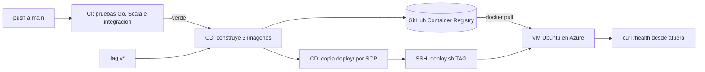

# Despliegue en Azure

Además del instalador, GameStats queda desplegado en una máquina virtual de Azure que se actualiza sola con cada cambio en `main`. Es un extra: muestra el sistema corriendo en un entorno remoto, pero la forma de entrega sigue siendo el instalador (ver [instalacion.md](instalacion.md)).

## Cómo funciona



1. Un push a `main` dispara la CI ([cicd.md](cicd.md)). Si termina en verde, el workflow `cd.yml` construye las imágenes del analyzer, el ingestor y el simulador, y las publica en GitHub Container Registry (GHCR) con dos etiquetas: el SHA corto del commit y `latest`. Un tag `v1.0.0` publica además la etiqueta `v1.0.0`.
2. Si el secreto `DEPLOY_HOST` está configurado, copia `deploy/docker-compose.prod.yml` y `deploy/deploy.sh` a `~/gamestats` en la VM y corre `./deploy.sh <SHA>` por SSH.
3. `deploy.sh` descarga esas imágenes, levanta los servicios y espera a que estén sanos.
4. El workflow comprueba desde afuera que `http://IP:8081/health` responde.

Sin `DEPLOY_HOST`, CD solo publica las imágenes y termina en verde. Así el repositorio funciona antes de crear la VM.

`docker-compose.prod.yml` es igual al de desarrollo, con tres diferencias:
- usa las imágenes publicadas en vez de compilarlas;
- se reinicia solo si la VM se reinicia;
- limita la memoria de cada servicio: analyzer 512 MB, ingestor y simulador 128 MB cada uno.

## 1. Crear la máquina virtual

En el portal de Azure, con la suscripción de Azure for Students: "Máquinas virtuales" → "Crear".

| Campo | Valor |
| --- | --- |
| Imagen | Ubuntu Server 24.04 LTS |
| Tamaño | B1s (1 vCPU, 1 GB). Entra en los servicios gratuitos de la suscripción de estudiante. Si se queda corta, B2s (2 vCPU, 4 GB) |
| Autenticación | Clave pública SSH |
| Usuario | `azureuser` (o el que se prefiera) |
| Puertos de entrada | 22 (SSH), 8080 (ingestor) y 8081 (analyzer y tablero) |
| IP pública | Estática, para que no cambie al apagar la VM |

La clave SSH conviene generarla aparte, solo para este despliegue:

```bash
ssh-keygen -t ed25519 -f ~/.ssh/gamestats_azure -C gamestats-deploy
```

En el portal se pega el contenido de `~/.ssh/gamestats_azure.pub`. La clave privada (`~/.ssh/gamestats_azure`, sin `.pub`) es la que va después como secreto en GitHub.

Si la VM ya existe, los puertos 8080 y 8081 se abren en "Redes" → "Reglas de puerto de entrada".

## 2. Preparar la VM

```bash
ssh -i ~/.ssh/gamestats_azure azureuser@IP_DE_LA_VM
curl -fsSL https://raw.githubusercontent.com/AndresZum/gamestats/main/deploy/setup-vm.sh | bash
exit
```

`setup-vm.sh` instala Docker con el script oficial, deja usarlo sin `sudo`, crea 1 GB de swap (una B1s tiene solo 1 GB de RAM) y crea la carpeta `~/gamestats`. Hay que salir y volver a entrar para que el permiso de Docker tenga efecto.

## 3. Secretos en GitHub

En el repositorio: Settings → Secrets and variables → Actions → New repository secret.

| Secreto | Valor |
| --- | --- |
| `DEPLOY_HOST` | IP pública de la VM |
| `DEPLOY_USER` | `azureuser` |
| `DEPLOY_SSH_KEY` | Contenido completo de la clave privada `~/.ssh/gamestats_azure` |
| `GHCR_PAT` | Opcional; ver el paso 4 |

El job de despliegue usa el environment `production`. GitHub lo crea solo la primera vez. En Settings → Environments se le puede agregar una aprobación manual antes de cada despliegue.

## 4. Acceso a las imágenes

GHCR crea los paquetes como privados. Hay dos opciones:

- Hacerlos públicos: en GitHub, perfil → Packages → `gamestats-analyzer` → Package settings → Change visibility → Public. Lo mismo para `gamestats-ingestor` y `gamestats-simulator`. Es lo más simple: el código ya es público y las imágenes no tienen secretos.
- Dejarlos privados y crear un token clásico con permiso `read:packages` (Settings → Developer settings → Personal access tokens). Ese token va en el secreto `GHCR_PAT`, y `deploy.sh` hace `docker login` con él.

## 5. Primer despliegue

Con los secretos cargados, cualquier push a `main` despliega. Para no esperar un push: Actions → CD → Run workflow no está disponible porque CD depende de CI, así que lo más rápido es Actions → CI → la última corrida de `main` → Re-run all jobs.

Al terminar, el job "Verificar que responde desde afuera" muestra la dirección del tablero: `http://IP_DE_LA_VM:8081/dashboard`.

Para llenar el tablero remoto desde la computadora propia, sin copiar nada a la VM:

```bash
cd simulator
go run ./cmd/simulator --mode http --target http://IP_DE_LA_VM:8080 --seed 0
```

Sin Go instalado, con Docker:

```bash
docker run --rm ghcr.io/andreszum/gamestats-simulator:latest --mode http --target http://IP_DE_LA_VM:8080 --seed 0
```

## Volver a una versión anterior

Cada imagen queda en GHCR con el SHA de su commit, así que volver atrás es desplegar un SHA anterior:

```bash
ssh -i ~/.ssh/gamestats_azure azureuser@IP_DE_LA_VM
cd ~/gamestats
./deploy.sh 1a2b3c4      # el SHA corto del commit que funcionaba (git log --oneline)
```

Lo mismo sirve con una versión: `./deploy.sh v1.0.0`. Los datos (`~/gamestats/gamestats-data`) no se tocan al cambiar de versión.

## Operación

- Ver el estado: `cd ~/gamestats && docker compose -f docker-compose.prod.yml ps`
- Ver los logs: `docker compose -f docker-compose.prod.yml logs -f analyzer`
- Generar partidas en la propia VM: `docker compose -f docker-compose.prod.yml --profile demo run --rm simulator`
- Ahorrar crédito: desde el portal, "Detener" la VM cuando no se use. Al volver a iniciarla, los contenedores arrancan solos.

## Seguridad

Los puertos 8080 y 8081 quedan abiertos a internet y sin autenticación. Para una demo alcanza, porque solo hay datos simulados. Para restringirlos, en la regla de entrada de cada puerto se pone como origen la IP propia en vez de "Any".

## Estado

El despliegue se probó localmente: `deploy.sh` con imágenes etiquetadas como en GHCR, la vuelta atrás a otra etiqueta, los límites de memoria y el simulador enviando por HTTP. Falta crear la VM y cargar los secretos. Cuando esté funcionando, aquí va la dirección pública del tablero.
